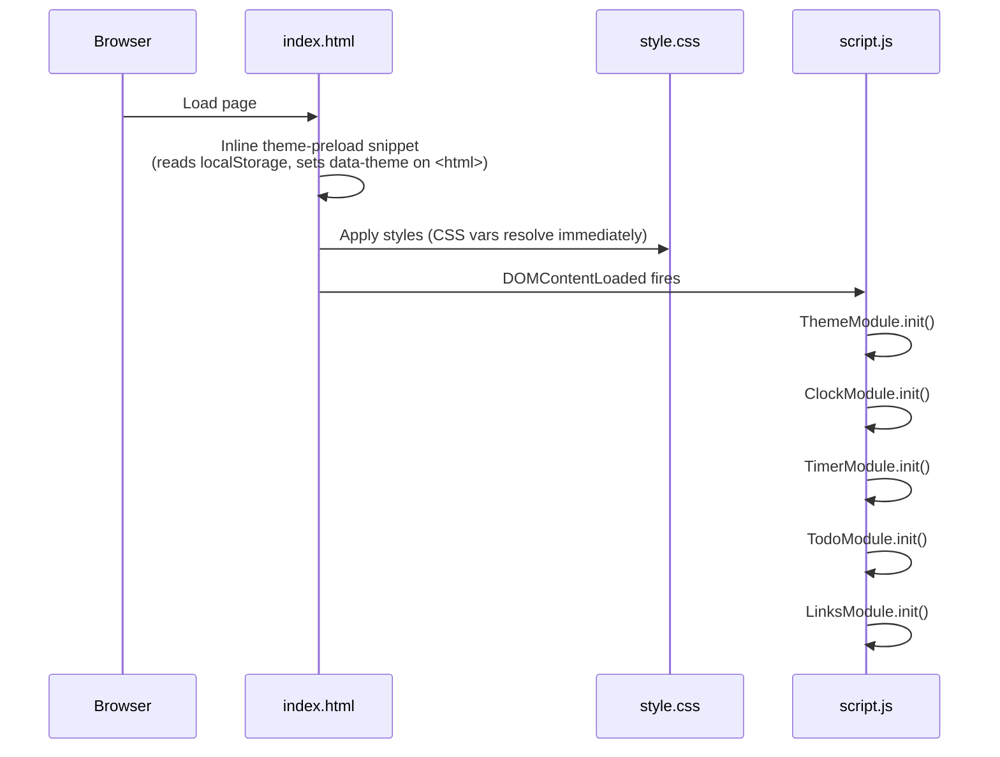

# Design Document

## Overview

The Todo Life Dashboard is a zero-dependency, single-page application delivered as three files: `index.html`, `css/style.css`, and `js/script.js`. It runs entirely in the browser, requiring no build step or server. All state is persisted to `window.localStorage`.

The page is composed of five logical modules:

| Module | Responsibility |
|---|---|
| Clock / Greeting | Live HH:MM:SS clock, date display, and time-sensitive personalised greeting |
| Focus Timer | 25-minute Pomodoro countdown with Start / Pause / Reset controls |
| To-Do List | Task CRUD with duplicate prevention and LocalStorage persistence |
| Quick Links | Bookmarks panel with URL validation and safe tab-opening |
| Theme | Dark / light toggle applied before first paint; colour tokens via CSS custom properties |

All modules are initialised on `DOMContentLoaded` and communicate only through shared LocalStorage keys and direct DOM manipulation. There is no reactive framework, no virtual DOM, and no module bundler.

---

## Architecture

### File layout

```
/
├── index.html          ← Single HTML document; inline <script> only for theme pre-load
├── css/
│   └── style.css       ← All styling; CSS custom properties for theming
└── js/
    └── script.js       ← All application logic; module-pattern IIFEs per component
```

### Execution sequence



### Theme pre-load strategy

A small inline `<script>` in `<head>` reads `localStorage.getItem('dashboard_theme')` and immediately sets `document.documentElement.dataset.theme` to `'dark'` or `'light'` before the stylesheet is applied, preventing a flash of the wrong theme. This is the only JavaScript that runs outside of `script.js`.

### Module pattern

Each module in `script.js` is an IIFE-based object literal exposed on a single `App` namespace:

```js
const App = {};

App.Clock = (function () {
  // private state
  let _intervalId = null;

  // public API
  return {
    init() { /* ... */ }
  };
})();
```

Modules do not import each other directly. Side-effects that cross module boundaries (e.g., re-rendering the greeting after a name change) are handled by re-calling the relevant module's render function.

---

## Components and Interfaces

### 1. ClockModule (`App.Clock`)

**Responsibility:** Update the live time, date, and greeting every second.

**Public API:**

| Method | Description |
|---|---|
| `init()` | Reads saved username, renders immediately, starts 1 000 ms interval |
| `render()` | Called by the interval; updates `#clock-time`, `#clock-date`, `#greeting-text` |
| `updateGreeting()` | Re-renders greeting text only (called by `App.User` after name save) |

**Greeting logic:**

| Hour range | Greeting |
|---|---|
| 05 – 11 | Good Morning |
| 12 – 17 | Good Afternoon |
| 18 – 20 | Good Evening |
| 21 – 04 | Good Night |

Hour is read with `new Date().getHours()` — always the device local timezone.

**DOM targets:**

```
#clock-time      ← HH:MM:SS
#clock-date      ← Full Weekday, Full Month Day, Year
#greeting-text   ← Greeting [, Name]
```

---

### 2. UserModule (`App.User`)

**Responsibility:** Persist and validate the display name.

**Public API:**

| Method | Description |
|---|---|
| `init()` | Reads from LocalStorage, pre-populates `#name-input` |
| `save(raw)` | Trims input; if empty removes key; if ≤ 50 chars saves; else no-op |
| `get()` | Returns the current name string or `''` |

**Validation:**

- Trim whitespace before comparing length.
- Maximum 50 characters (enforced on input via `maxlength="50"` attribute and re-validated in JS).
- If LocalStorage value's trimmed length exceeds 50 chars, treat as empty.

---

### 3. TimerModule (`App.Timer`)

**Responsibility:** 25-minute countdown timer.

**State:**

```js
{
  remaining: 1500,   // seconds; starts at 25 * 60
  running: false,
  complete: false,
  _intervalId: null
}
```

**Public API:**

| Method | Description |
|---|---|
| `init()` | Renders initial 25:00 display |
| `start()` | Guards against duplicate intervals; begins 1 000 ms tick |
| `pause()` | Clears interval; sets `running = false` |
| `reset()` | Clears interval; resets all state; shows Start/Pause controls again |
| `_tick()` | Decrements remaining; at 0 calls `_complete()` |
| `_complete()` | Sets `complete = true`; shows "Session Complete" label |
| `_render()` | Formats `remaining` as `MM:SS`; updates `#timer-display` |

**Single-interval guard:** `start()` calls `clearInterval(this._intervalId)` before setting a new interval, ensuring only one interval can exist at a time regardless of call order.

**DOM targets:**

```
#timer-display   ← MM:SS
#timer-start     ← Start / Resume button
#timer-pause     ← Pause button
#timer-reset     ← Reset button
#timer-complete  ← "Session Complete" label (hidden until complete)
```

---

### 4. TodoModule (`App.Todo`)

**Responsibility:** Full CRUD for tasks with duplicate detection and LocalStorage persistence.

**Public API:**

| Method | Description |
|---|---|
| `init()` | Loads from LocalStorage; renders list |
| `add(title)` | Validates, deduplicates, creates Task, persists, re-renders |
| `edit(id, newTitle)` | Validates, deduplicates against other tasks, updates, persists |
| `toggle(id)` | Flips `completed`; persists |
| `delete(id)` | Removes by id; persists |
| `_save()` | Serialises task array to `localStorage.setItem('dashboard_tasks', JSON.stringify(tasks))` |
| `_load()` | `JSON.parse` wrapped in try/catch; returns `[]` on failure |
| `_render()` | Rebuilds `#task-list` from current state using `createTextNode` |
| `_isDuplicate(title, excludeId?)` | Case-insensitive, trimmed comparison against active task titles |

**Duplicate detection:**

```js
_isDuplicate(title, excludeId = null) {
  const norm = title.trim().toLowerCase();
  return this._tasks.some(t => t.id !== excludeId && t.title.trim().toLowerCase() === norm);
}
```

**Task creation:**

```js
{ id: String(Date.now()), title: title.trim(), completed: false }
```

**DOM targets:**

```
#task-input      ← New task text input
#task-add-btn    ← Add button
#task-list       ← <ul> rebuilt on every state change
#task-error      ← Error message element (shown/hidden)
```

---

### 5. LinksModule (`App.Links`)

**Responsibility:** Quick-links bookmarks panel.

**Default links (shown when LocalStorage is empty):**

```js
[
  { id: 'default-1', label: 'GitHub', url: 'https://github.com' },
  { id: 'default-2', label: 'MDN Web Docs', url: 'https://developer.mozilla.org' },
  { id: 'default-3', label: 'Google', url: 'https://www.google.com' }
]
```

**Public API:**

| Method | Description |
|---|---|
| `init()` | Loads from LocalStorage (or defaults); renders list |
| `add(label, url)` | Validates label (non-empty, ≤ 100 chars) and URL scheme; creates Link; persists |
| `delete(id)` | Removes by id; persists |
| `_validateUrl(url)` | Returns `true` only if URL starts with `http://` or `https://` |
| `_save()` | Persists to `'dashboard_links'` |
| `_load()` | try/catch JSON.parse; returns default links on failure |
| `_render()` | Rebuilds `#links-list`; sets `rel="noopener noreferrer"` and `target="_blank"` on every anchor |

**DOM targets:**

```
#link-label-input  ← Label input
#link-url-input    ← URL input
#link-add-btn      ← Add button
#links-list        ← <ul> rebuilt on every state change
#link-error        ← Error message element
```

---

### 6. ThemeModule (`App.Theme`)

**Responsibility:** Toggle dark/light theme; persist preference.

**Public API:**

| Method | Description |
|---|---|
| `init()` | Reads LocalStorage; applies `data-theme` attribute to `<html>`; syncs toggle button label |
| `toggle()` | Flips current theme; persists; updates `data-theme` and button |

**Pre-load snippet (inline in `<head>`):**

```html
<script>
  (function () {
    var t = localStorage.getItem('dashboard_theme');
    document.documentElement.dataset.theme = (t === 'light') ? 'light' : 'dark';
  })();
</script>
```

This runs synchronously before CSS is applied so there is zero flicker.

---

## Data Models

### Task

```ts
interface Task {
  id: string;        // String(Date.now()) at creation time — unique per session
  title: string;     // Trimmed user input; 1–∞ chars (enforced before creation)
  completed: boolean; // false on creation; toggled by user
}
```

### Link

```ts
interface Link {
  id: string;   // String(Date.now()) or 'default-N' for pre-populated links
  label: string; // Trimmed; 1–100 chars
  url: string;  // Must start with http:// or https://
}
```

### LocalStorage keys

| Key | Type | Default |
|---|---|---|
| `dashboard_tasks` | `Task[]` (JSON) | `[]` |
| `dashboard_links` | `Link[]` (JSON) | 3 default links |
| `dashboard_theme` | `'dark' \| 'light'` | `'dark'` |
| `dashboard_username` | `string` | `''` (key absent) |

### CSS custom properties (theme tokens)

All colours are defined on `:root[data-theme="dark"]` and `:root[data-theme="light"]`. Components use only the token names, never hardcoded hex values, enabling instantaneous theme switching with a single attribute change.

```css
:root[data-theme="dark"] {
  --color-bg:         #0A0A0C;
  --color-card:       #141418;
  --color-surface:    #1D1D23;
  --color-text:       #F5F5F7;
  --color-text-sec:   #A1A1AA;
  --color-border:     #2B2B32;
  --color-accent:     #DC143C;
  --color-highlight:  #FF334F;
}

:root[data-theme="light"] {
  --color-bg:         #FFFFFF;
  --color-card:       #F5F5F7;
  --color-surface:    #EBEBEB;
  --color-text:       #0A0A0C;
  --color-text-sec:   #4A4A55;
  --color-border:     #D1D1D8;
  --color-accent:     #DC143C;
  --color-highlight:  #FF334F;
}
```

### Layout breakpoints

```css
/* Mobile-first base: single column, 320px+ */
.dashboard-grid {
  display: grid;
  grid-template-columns: 1fr;
}

/* Two-column grid at 768px+ */
@media (min-width: 768px) {
  .dashboard-grid {
    grid-template-columns: 1fr 1fr;
  }
}
```

Minimum font size: `12px` (set as `font-size: clamp(12px, 1rem, 16px)` on `body`).  
Minimum touch target: all buttons have `min-width: 44px; min-height: 44px`.

---

## Correctness Properties

*A property is a characteristic or behavior that should hold true across all valid executions of a system — essentially, a formal statement about what the system should do. Properties serve as the bridge between human-readable specifications and machine-verifiable correctness guarantees.*

### Property 1: Task persistence round-trip

*For any* array of valid Task objects (with non-empty trimmed titles, boolean completed flags, and unique string ids), serialising the array to LocalStorage and immediately deserialising it shall produce an array structurally equal to the original — same ids, titles, and completed flags — and the application shall render exactly those tasks on load.

**Validates: Requirements 5.2, 5.3, 5.4**

---

### Property 2: Whitespace-only task titles are rejected

*For any* string composed entirely of whitespace characters (spaces, tabs, newlines), attempting to add it as a task title shall leave the task list unchanged and the LocalStorage state shall not be modified.

**Validates: Requirements 5.2**

---

### Property 3: Duplicate task prevention

*For any* existing task list and any new title whose trimmed, case-insensitive value matches an existing active task title (including case variants and extra surrounding whitespace), the submission shall be rejected and the task list shall remain the same size with unchanged contents.

**Validates: Requirements 6.1, 6.3**

---

### Property 4: Task completion toggle is an involution

*For any* task in the list, toggling its completion state twice shall return it to its original completion state, and the persisted LocalStorage value shall reflect that original state.

**Validates: Requirements 8.2, 8.3**

---

### Property 5: Greeting function covers all hours correctly

*For any* local hour value in [0, 23], the greeting function shall return exactly one of the four greeting strings (`Good Morning`, `Good Afternoon`, `Good Evening`, `Good Night`), the returned string shall correspond to the correct hour-range bucket (05–11, 12–17, 18–20, 21–04), and when a non-empty User_Name is provided the output shall equal `${greeting}, ${name.trim()}`.

**Validates: Requirements 2.1, 2.2, 2.3, 2.4, 2.5**

---

### Property 6: Link URL validation rejects non-HTTP schemes

*For any* URL string that does not begin with `http://` or `https://` (including `javascript:`, `data:`, relative paths, bare hostnames, and empty strings), the link submission shall be rejected and the links list shall remain unchanged.

**Validates: Requirements 9.4, 12.4**

---

### Property 7: Valid link addition round-trip

*For any* Link with a non-empty label of ≤ 100 characters and a URL beginning with `http://` or `https://`, adding it and then loading from LocalStorage shall yield a links list that contains a link with that exact trimmed label and URL, and the rendered anchor shall carry `rel="noopener noreferrer"` and `target="_blank"`.

**Validates: Requirements 9.3, 9.5, 12.3**

---

### Property 8: Timer display format is always MM:SS

*For any* remaining-seconds value in [0, 1500], the timer format function shall return a string matching `MM:SS` where both MM and SS are zero-padded two-digit numbers, MM equals `Math.floor(seconds / 60)` zero-padded, and SS equals `seconds % 60` zero-padded.

**Validates: Requirements 4.9**

---

## Error Handling

### LocalStorage read failures

Every `JSON.parse` call on LocalStorage data is wrapped in a `try/catch`. On failure the module falls back to a safe default (`[]` for tasks, default links array for links, `'dark'` for theme, `''` for username) and continues normal operation. No error is surfaced to the user for parse failures on load.

### LocalStorage write failures

`localStorage.setItem` can throw a `QuotaExceededError` in private-browsing mode or when storage is full. All `_save()` methods wrap the write in a try/catch. If the write fails, the in-memory state is still consistent; the user will lose changes on page reload, but the application will not crash.

### Malformed URL rejection

`LinksModule._validateUrl` uses a strict prefix test (`url.startsWith('http://') || url.startsWith('https://')`). An additional `new URL(url)` construction wrapped in try/catch can be used for deeper validation. Any URL that fails either check displays an error message in `#link-error` without creating a Link.

### Invalid user input

All form submissions are validated before any state mutation. Error messages are set via `element.textContent = '...'` (never `innerHTML`). Error elements are cleared on the next successful submission or on input focus.

### Timer edge cases

- Calling `start()` on an already-running timer is a no-op (interval guard prevents duplicate intervals).
- Calling `pause()` when not running is a no-op (`clearInterval(null)` is safe).
- Calling `reset()` in any state is always safe; it calls `clearInterval` unconditionally.

### XSS prevention

- All user-supplied strings (task titles, link labels, username) are written to the DOM exclusively via `element.textContent = value` or `document.createTextNode(value)`.
- No user data is ever passed to `innerHTML`, `insertAdjacentHTML`, or `eval`.
- All Quick Links anchors are created with `setAttribute('rel', 'noopener noreferrer')` and `setAttribute('target', '_blank')`.

---

## Testing Strategy

### Dual testing approach

Unit tests verify specific scenarios and edge cases with concrete inputs. Property-based tests verify universal invariants across large generated input spaces. Both are required for full confidence.

### Unit tests (example-based)

Focused on:

- **ClockModule:** greeting returns correct string for each of the four hour buckets; boundary values (5, 11, 12, 17, 18, 20, 21, 4).
- **UserModule:** save/get round-trip; empty string removes key; trimmed value > 50 chars is rejected.
- **TimerModule:** `start()` then immediate second call does not create a second interval; `reset()` restores to 1500 seconds; `_complete()` fires at `remaining === 0`.
- **TodoModule:** add → delete leaves empty list; toggle → toggle restores original state; malformed LocalStorage initialises to `[]`.
- **LinksModule:** default links shown when storage empty; malformed storage restores defaults; `javascript:` URL rejected; `data:` URL rejected.
- **ThemeModule:** invalid stored value defaults to `'dark'`; toggle from dark produces light and vice-versa.

### Property-based tests

Using a JavaScript PBT library (e.g., [fast-check](https://github.com/dubzzz/fast-check)); minimum 100 iterations per property.

Each test is tagged with a comment in the format:
`// Feature: todo-life-dashboard, Property N: <property_text>`

| Property | Generator inputs | Assertion |
|---|---|---|
| P1 Task persistence round-trip | `fc.array(arbTask, { minLength: 1 })` | `JSON.parse(JSON.stringify(arr))` deep-equals original; all tasks rendered on load |
| P2 Whitespace-only rejection | `fc.string().filter(s => s.trim() === '')` (non-empty) | Task list size unchanged; LocalStorage not modified |
| P3 Duplicate prevention | Existing task list + case/whitespace variant of an existing title | List size unchanged |
| P4 Toggle involution | Arbitrary Task; toggle twice | `completed` back to original; LocalStorage matches |
| P5 Greeting correctness | `fc.integer({min:0,max:23})` + `fc.option(fc.string({minLength:1,maxLength:50}))` | Correct bucket string; name appended with `, ` when present |
| P6 URL validation rejects non-HTTP | `fc.string().filter(s => !s.startsWith('http://') && !s.startsWith('https://'))` | Submission rejected; list unchanged |
| P7 Link round-trip | `fc.record({ label: fc.string({minLength:1,maxLength:100}), url: fc.constantFrom('http://x','https://y') })` | Loaded list contains link; anchor has correct rel/target |
| P8 Timer MM:SS format | `fc.integer({min:0,max:1500})` | Output matches `MM:SS` pattern with correct numeric values |

### Integration smoke test

A single manual or Playwright-based smoke test confirms:

1. Page loads without JS errors.
2. Clock ticks (observe two consecutive renders).
3. Add task → refresh → task persists.
4. Add link → refresh → link persists.
5. Toggle theme → refresh → correct theme applied without flicker.
6. Timer reaches 0:00 → "Session Complete" shown; Reset restores 25:00.
